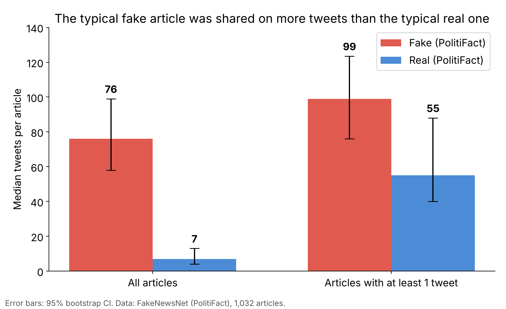
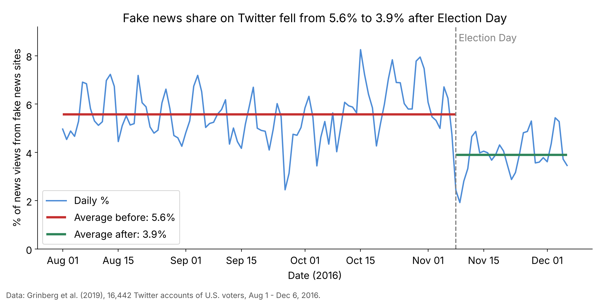
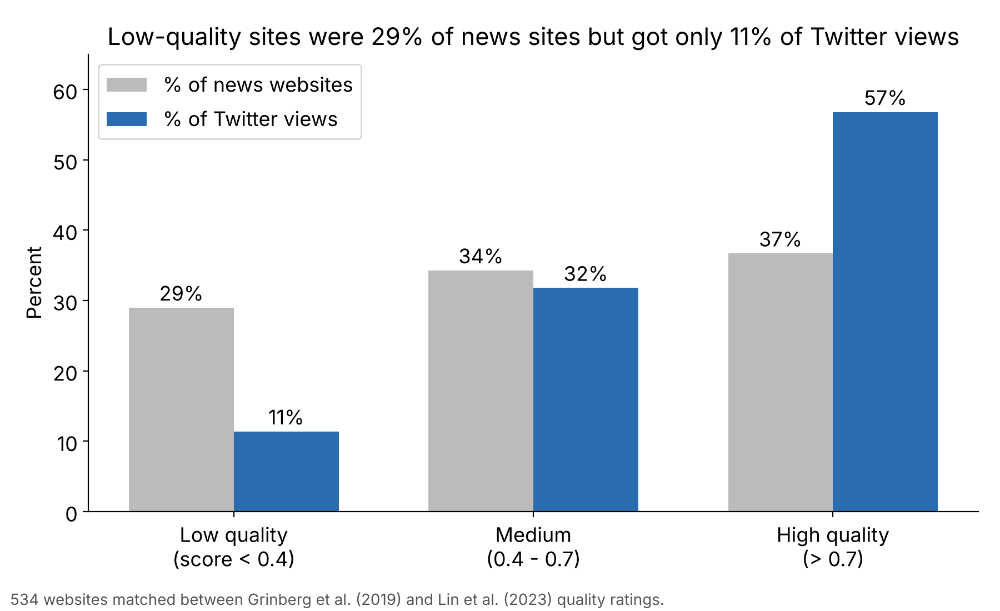

## Main Findings (Narrative Analysis)

- The typical fake political article in FakeNewsNet was shared on more tweets than the typical real one (median 76 vs. 7 tweets), even though the most viral articles were real.
- On Twitter, the share of news views that came from fake news sites was lower after Election Day than before it (3.9% vs. 5.6% of daily views).
- Low-quality news websites were 29% of the sites in our Twitter data but got only about 11% of the views, and a typical low-quality site got about half the views of a typical high-quality site.

**How to reproduce:** run `narrative.ipynb` from top to bottom (needs pandas, numpy and matplotlib). It downloads the data, prints every number in this section, and saves the three figures to `figures/`. Longer notes on the analyses we left out are in [NARRATIVE.md](NARRATIVE.md).

### Finding 1: The typical fake article was shared more, but the most viral articles were real

We compared tweet counts for 423 fake and 609 real PolitiFact articles in FakeNewsNet. The median fake article was shared on 76 tweets and the median real article on 7. The 95% bootstrap confidence interval for the difference is 49 to 92 tweets, and a permutation test gave p < 0.001, so the gap is very unlikely to be just chance. A small p-value doesn't tell us how big or important the gap is, though. If you pick one random fake and one random real article, the fake one has more tweets about 64% of the time. The mean tells a different story: real articles average 643 tweets and fake ones 376, because the most viral real articles have far more tweets (the 90th percentile is 1,537 tweets for real vs. 745 for fake). So fake news wins for the *typical* article, but not at the very top. One alternative explanation is a data collection quirk: FakeNewsNet found tweets by searching for the headline, and 35% of real articles have 0 tweets found, compared with only 9% of fake ones. To check this, we kept only articles with at least 1 tweet. The gap got smaller (99 vs. 55 tweets, 95% CI for the difference 9.5 to 72) but did not go away. We also checked a second platform: on Facebook (BuzzFeed data), "mostly false" posts had a median of 1,178 shares vs. 57 for "mostly true." Part of that is a confounder, the type of page, because mainstream pages post mostly true content and get few shares. Within right-leaning pages the gap still holds (1,019 vs. 92), and within left-leaning pages it's smaller (4,587 vs. 2,296). We can only say fake articles were *associated* with more sharing, not that being fake *causes* more sharing.

### Finding 2: The fake news share on Twitter dropped after Election Day

Finding 1 is about single articles, so next we looked at how much of all the news people saw was fake over time. In the Grinberg et al. panel of 16,442 Twitter users, an average of 5.6% of daily political news views came from fake news sites in the 99 days before Election Day. In the 29 days from Election Day on, the average was 3.9%. That's a drop of 1.7 percentage points (95% bootstrap CI 1.3 to 2.0, permutation test p < 0.001). One alternative explanation is the day of the week, since weekends have more fake news. The drop holds on both weekdays (5.2% → 3.5%) and weekends (6.6% → 4.8%). Another issue is that days next to each other are similar, which makes daily tests too confident, so we redid the comparison with weekly averages (15 weeks before, 5 after). We got almost the same gap with a similar CI (1.3 to 2.1). Finally, the days right after the election had huge news volume, and more total news goes with a lower fake share (correlation −0.51). After dropping Nov 8–10, the after-election average is still 4.1%. We can't say the election *caused* the drop, because news topics and attention changed at the same time. And the "after" period is only 4 weeks.

### Finding 3: Low-quality news sites got a small share of the views

Findings 1 and 2 suggest fake news spreads well per article but is still a small part of what people see. To see why, we joined the Twitter website totals with the Lin et al. (2023) quality scores (534 sites matched). Low-quality sites (score under 0.4) were 29% of the sites but got only 11.4% of the views (95% bootstrap CI 6.4% to 18.2%, from resampling websites). High-quality sites (over 0.7) were 37% of sites and got 57% of views. The median low-quality site had 5,304 views vs. 11,185 for the median high-quality site (95% CI for the difference 1,140 to 9,503). Quality and views are only weakly related (Spearman correlation 0.17), so there's a lot of overlap. One alternative explanation is that a few giant mainstream sites drive everything. When we drop the 10 most-viewed sites, low-quality sites still get only 15.1% of views. Our 0.4 cutoff was our own choice, so we also tried 0.3 and 0.5, and the low-quality share stays small (8.6% to 15.5%). We also found that low-quality views are concentrated: breitbart.com alone has 20.8% of them and the top 10 low-quality sites have 57.4%. High-quality views are just as concentrated, though, so this is true of news in general. One limit is that the 72 sites without a rating (1.6% of views) are left out, and the ratings are from 2023, not 2016.

---

# CS 418 Group Project: Fake News on Social Media

**Team:** Krish Patel, Mahi Patel, Dravya Dholakiya

## Research Questions

1. Does fake news get shared more than real news on social media (Twitter and Facebook)?
2. During the 2016 election, how much of the news people saw on Twitter came from fake news websites, and did that change closer to election day?
3. Do low-quality news websites get more attention on social media than high-quality ones?

## Primary Datasets

**1. Fake News on Twitter During the 2016 Election**
- Source: Grinberg et al., *Science* 2019 (also in the class datasets folder)
- Link: https://github.com/LazerLab/twitter-fake-news-replication
- Two files: daily counts of fake news on Twitter, and total views per news website

**2. FakeNewsNet (PolitiFact)**
- Source: Shu et al., 2020
- Link: https://github.com/KaiDMML/FakeNewsNet
- News articles that PolitiFact labeled fake or real, with the tweets that shared each one

## Secondary Datasets

**1. BuzzFeed Facebook Fact-Check (2016)**
- Link: https://github.com/BuzzFeedNews/2016-10-facebook-fact-check
- Facebook posts from political pages, rated true or false, with share counts. We will **compare** it with the Twitter data to see if fake news gets more shares on Facebook too.

**2. News Website Quality Ratings**
- Source: Lin et al., *PNAS Nexus* 2023
- Link: https://github.com/hauselin/domain-quality-ratings
- A quality score (0 to 1) for each news website. We will **join** it with the Twitter website data on the website name (like `cnn.com`).

## Getting the Data

All four datasets load from their URLs in `data_acquisition.ipynb` using `pd.read_csv`. The data files are not saved in this repo.

## What the Data Looks Like

| Dataset | Rows | Columns | One row is |
|---|---|---|---|
| Twitter daily counts | 128 | 10 | one day |
| Twitter website totals | 606 | 2 | one news website |
| FakeNewsNet (PolitiFact) | 1,056 | 5 | one news article |
| Facebook fact-check | 2,282 | 12 | one Facebook post |
| Website quality ratings | 11,520 | 2 | one news website |

**Twitter daily counts**
- Time: Aug 1 to Dec 6, 2016. Place: United States.
- Important columns: `date` (text), `N` (int, total news views that day), `pct_fake` (float, fraction of views from fake news sites)
- First look (chart in the notebook): The share of Twitter news views coming from fake news sites mostly stayed between about 4% and 7% during the 2016 campaign, peaking at around 8% in mid-October. It then dropped sharply on Election Day, to about 2% on Nov 8–9, and averaged about 3.9% after the election compared with about 5.6% before it.

**Twitter website totals**
- Columns: `website` (text), `N` (int, total views)

**FakeNewsNet**
- 432 fake and 624 real articles
- Important columns: `title` (text), `news_url` (text), `tweet_ids` (text, list of tweet IDs), `label` (fake/real, added by us)
- There is no date column.

**Facebook fact-check**
- Time: Sept 19 to 27, 2016. 9 Facebook pages.
- Important columns: `Rating` (text: mostly true / mostly false / mixture / no factual content), `share_count` (float), `Category` (mainstream, left, right)
- We checked the missing values in each column using `facebook.isna().sum()` since some values in `share_count` are missing.
- We grouped the posts by `Rating` and calculated the median `share_count` for each group.
- We also made a simple bar chart to compare the median number of shares between the different ratings.
- This gives us a first look at whether posts with different levels of factual accuracy received different amounts of engagement on Facebook.
- Since the dataset only covers 9 Facebook pages over about one week, we should be careful about treating the results as representative of all Facebook activity.
- Later, we can compare these Facebook engagement patterns with the Twitter data to see if the same type of content gets similar attention across both platforms.

**Website quality ratings**
- Columns: `domain` (text), `pc1` (float, quality score)
- 534 of the 606 Twitter websites have a rating, so the join should work.

## Notes / Problems

- The Twitter data only has daily totals, not individual tweets. The individual-level data is private.
- Some FakeNewsNet articles have no tweets and some have no URL.
- The Facebook data only covers one week.

## Data documentation

More details about the datasets, limitations, and people represented in the data are available in [DATASHEET.md].

### Datasets

- **Twitter 2016:** Grinberg et al. (2019), Zenodo DOI 10.5281/zenodo.2483311. License: Other (Open).
- **FakeNewsNet:** Shu et al. (2020), github.com/KaiDMML/FakeNewsNet. No license file is provided; copyright is listed as © 2019 Arizona Board of Regents on behalf of Arizona State University.
- **Facebook fact-check:** BuzzFeed News (2016), github.com/BuzzFeedNews/2016-10-facebook-fact-check. No license file is provided.
- **Website quality ratings:** Lin et al. (2023), github.com/hauselin/domain-quality-ratings. No license file is provided, but the README says the data may be reused.

### Main limitation

Our biggest limitation is that the Twitter dataset only gives daily and website-level totals, not individual tweets or individual exposure records. FakeNewsNet mainly provides tweet IDs found using headline searches, so we cannot fully tell who actually saw each article or how every article spread.
